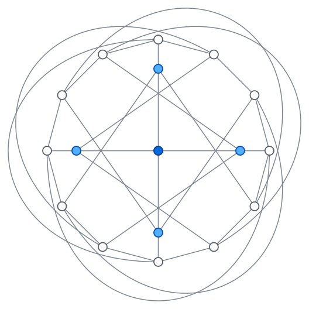

# Smallest treewidth achieved by a graph with fewer edges than the complete graph

> A natural family of graphs to consider are the
> [cliques](https://en.wikipedia.org/wiki/Clique_(graph_theory)): a clique on
> $k+1$ vertices has treewidth $k$, and has $k (k+1) / 2$ edges. However,
> asymptotically, there are graphs of treewidth $k$ whose number of edges is
> linear rather than quadratic, e.g., cubic expanders as mentioned in
> [this question](https://cstheory.stackexchange.com/questions/39071/maximum-treewidth-of-a-graphs-with-m-edges).
> So cliques are not optimal. My question is: **what is the smallest example
> of a graph of treewidth $k$ having less edges than the $(k+1)$-clique?**
>
> — Antoine Amarilli, [TCS Stack Exchange](https://cstheory.stackexchange.com/questions/53806/what-is-the-smallest-graph-of-treewidth-k-having-less-edges-than-the-k1-c)

**The smallest treewidth $k$ at which a graph can have fewer edges than
$K_{k+1}$ is $k = 8$. The minimum number of edges at treewidth eight is 34.**

**The extremal graph is not unique:** there are exactly **two connected
34-edge graphs of treewidth eight**, up to isomorphism, on 16 and 17 vertices.
Both are triangle-free. See [the classification](proof.md#8-classification-at-34-edges-exactly-two-connected-graphs).

| Treewidth $k$ | Edges of $K_{k+1}$ | Minimum number of edges |
| ---: | ---: | ---: |
| 6 | 21 | 21 |
| 7 | 28 | 28 |
| 8 | 36 | **34** |

For every $k \le 7$, the clique is optimal. This repository contains the
[proof](proof.md), the code for its computer-assisted step, and the saved
certificates. The results have not yet been externally reviewed.

## A 34-edge graph of treewidth eight

<p align="center">
  
</p>

*The 12 ring vertices form a Möbius ladder: a 12-cycle plus its six
diameters, drawn as loops outside the ring. Each of the four inner vertices is
joined to every fourth ring vertex, and the centre vertex is joined to all four
inner vertices.*

Its graph6 code is

```text
Ps`aa?aGOgAGBCA`@L?@K?ES
```

It comes from House of Graphs' quartic archive and is not claimed as a new
construction.

<p align="center">
  
</p>

*The twelve white ring vertices form a cycle with six additional matching
edges drawn outside. The four blue vertices form an inner four-cycle, and
each joins three ring vertices.*

The other extremal graph has 16 vertices: twelve of degree four and four of
degree five. Its graph6 code is

```text
O?qbF_WF_cA__IOBCC_Af
```

Its [adjacency lists and proof](proof.md#the-second-graph) and
[certificates](sources/witness34-16.json) are included. A width-eight order
and a closed-prefix certificate of 3,621 sets establish its exact treewidth.
Its different vertex count alone disproves uniqueness of the original witness.

## Proof outline

The key step is a classification: **every connected graph with at most 28
edges and treewidth at least seven is $K_8$ or one 12-vertex graph $F$.**

1. **The classification.** Eliminating vertices of degree at most three and
   adding a few edges turns any such graph into a connected graph with 28
   edges, 8–14 vertices, and degrees 4–7. All **96,841,893** of these have
   verified width-six elimination orders, except $K_8$ and $F$. Deleting an
   edge of either, or replacing a triangle by a star, lowers the treewidth to
   six, so the original graph was $K_8$ or $F$ all along.
2. **Treewidth seven needs 28 edges,** because $K_8$ and $F$ both have 28.
   The Joret–Wood bound handles treewidths up to six.
3. **Treewidth eight needs 34 edges.** Deleting a maximum-degree vertex from
   a smallest counterexample with at most 33 edges leaves a connected
   28-edge graph of treewidth at least seven on 13–15 vertices, which the
   classification rules out.
4. **34 edges suffice:** the 17-vertex, 4-regular graph pictured above has
   treewidth exactly eight.

### How the results are certified

An *elimination order* of width $w$ proves treewidth at most $w$, and a
*closed-prefix certificate* proves treewidth greater than $w$. Every order is
checked by a separate routine that uses paths in the original graph instead
of filling, and every saved certificate is checked in Python; see
[Section 7 of the proof](proof.md#7-how-the-computation-is-certified) for
details. The proof relies on the published Joret–Wood theorem, the
completeness of nauty's isomorphism-class generation, and the verifiers in
this repository. None of these has been formally verified in a proof
assistant.

## Reproduce the minimum-edge proof

Requirements: Python 3.10 or later, a C compiler supporting GCC-style builtins
(GCC or Clang), `pkg-config`, and nauty development files including `geng.c`.
The checked run used nauty 2.8.8. Other versions may label the two
exceptional graphs ($K_8$ and $F$) differently from the saved encodings and
have not been tested. On Debian/Ubuntu:

```sh
sudo apt-get install python3 build-essential pkg-config libnauty2-dev nauty
```

From the repository root:

```sh
python3 scripts/reproduce.py
```

This runs the enumeration, certifies the facts about $K_8$, $F$, and the
34-edge graph, and rechecks the saved certificates. A successful run ends
with:

```text
PASS: every computational step of Sections 1–7 of proof.md verified.
```

Allow a few minutes, depending on hardware. No network access, graph archive
download, or Python packages are needed. Executables and intermediate order
logs are built in a temporary directory and removed on completion. The result
file `sources/results.json` is regenerated with local timings, compiler
information, and source hashes, which may differ from the saved run.

**Do not use Python's `-O` flag:** assertions are verification steps, and the
scripts refuse to run under it. The scripts can be run from any working
directory.

The default generator source is `/usr/share/nauty/geng.c`. To use another
installation or compiler:

```sh
GENG_SOURCE=/path/to/geng.c CC=clang python3 scripts/reproduce.py
```

Nauty's headers and libraries must be discoverable through `pkg-config nauty`;
set `PKG_CONFIG_PATH` if necessary. Nauty is installed separately, not bundled.

## Reproduce the classification at 34 edges

The classification uses a smaller search than directly enumerating all
34-edge degree sequences: it classifies **518,071,774** cores with 29 edges,
reconstructs **15,091** possible graphs with a degree-five vertex, and checks
all **86,221,634** connected quartic graphs on 17 vertices. Exactly two
nonisomorphic graphs survive.

Run `scripts/reproduce.py` first for the minimum-edge results and 28-edge
classification used in the reduction. The following command verifies the
additional computation in Section 8; it does not repeat that earlier search.

In addition to the requirements above, obtain the full
[nauty 2.8.8 source distribution](https://users.cecs.anu.edu.au/~bdm/nauty/nauty2_8_8.tar.gz),
including `genquarticg.c` and `quarticirred28.h`.
Some development packages install `geng.c` but omit `genquarticg.c`. Then run:

```sh
python3 scripts/reproduce_uniqueness.py \
  --genquartic-source /path/to/nauty/genquarticg.c
```

The script compiles the generators and checkers in a temporary directory,
checks every successful elimination order, independently repeats the nauty
counts, and saves the results and reconstruction certificates. It finishes:

```text
PASS: exactly two connected 34-edge graphs have treewidth eight.
```

Allow roughly 10–20 minutes depending on hardware. The 29-edge cases use
three worker processes by default; select another limit with `--workers N`.
The script performs no downloads. Its saved source hashes include the
external generator sources used for the run.

The saved classification was also independently repeated with GENREG for the
quartic case. To reproduce that cross-check, obtain `gendef.h`, `genreg.c`,
`main.c`, and `optmid.c` from the
[GENREG trunk source](https://svn.code.sf.net/p/genreg/code/trunk/)
(checked revision: 5), and add:

```sh
  --cross-check-genreg --genreg-source /path/to/genreg
```

Alternatively, select `--quartic-generator genreg --genreg-source /path/to/genreg`,
or `--quartic-generator geng` to use the general nauty generator throughout.
The latter needs no additional generator source but is substantially slower
in our quartic pilot. All choices cover the same connected quartic family.

### Why genquarticg?

`geng` is a highly optimized general graph generator. The quartic case is
better suited to a specialized regular-graph generator: nauty's
`genquarticg` by Brendan McKay and S. Narjess Afzaly, or Markus Meringer's
GENREG. The initial calculation used GENREG. We now default to `genquarticg`
for its direct checker interface and shared nauty dependency, retaining
GENREG as an independent cross-check.
Both produce the published count of 86,221,634 connected quartic graphs on
17 vertices, and both leave precisely the same witness up to isomorphism.
The [local benchmark](sources/generator-benchmark.json) records a matched
count-only comparison on 16 vertices, with both built using `-O3`: their CPU
times were essentially tied, 19.49 and 19.57 seconds respectively. This is a
measurement of one workload, not a general ranking of the software; generation
and treewidth checking together may have different timings.
In the complete saved 17-vertex run, generation and checking took 297.6 seconds
with `genquarticg` and 304.3 seconds with GENREG; both found the same sole
quartic witness. These local wall-clock timings are recorded in
`sources/uniqueness.json`.

The `genquarticg` route calls the existing verified C checker directly through
its `OUTPROC` hook, avoiding an additional graph-format decoder. The GENREG
route uses the independently checked shortcode reader. `geng` remains the
generator for the 29-edge cores, whose degrees need not all be equal.

## Faster certificate check

With only Python's standard library, run:

```sh
python3 scripts/verify_certificates.py
```

This checks source hashes, the exact treewidths of $K_8$, $F$, and both
34-edge graphs, and the width-six orders for every reduction of $K_8$ and $F$.
It does **not** repeat the exhaustive enumeration; use the full run for that.

To additionally replay every reconstruction and check its pruning and final
orders, also using only Python's standard library:

```sh
python3 scripts/verify_uniqueness.py
```

This verifies both witnesses, all 924 degree-six attachments, and the full
15,091-candidate reconstruction. It does **not** repeat the 29-edge or quartic
enumerations; their completeness requires the full classification run.

## Files

- [proof.md](proof.md): the complete proof.
- [scripts/reproduce.py](scripts/reproduce.py): full reproduction.
- [scripts/verify_certificates.py](scripts/verify_certificates.py): Python-only
  check of the saved certificates.
- [scripts/treewidth.c](scripts/treewidth.c): C search and independent order
  verifier, used as a `geng` plugin or standalone graph6 checker.
- [scripts/reference.py](scripts/reference.py): independent Python reference
  algorithms.
- [sources/results.json](sources/results.json): enumeration counts, source
  hashes, and certificates for $K_8$ and $F$ and all their reductions.
- [sources/witness34.json](sources/witness34.json),
  [graph6 file](sources/witness34.g6), and [drawing](sources/witness34.svg):
  the 34-edge graph and its certificates.
- [sources/witness34-16.json](sources/witness34-16.json) and
  [graph6 file](sources/witness34-16.g6), plus the
  [drawing](sources/witness34-16.svg): the second extremal graph and certificates.
  Regenerate the SVG with `python3 scripts/draw_witness16.py`.
- [scripts/reproduce_uniqueness.py](scripts/reproduce_uniqueness.py): full
  classification, using [extend29.py](scripts/extend29.py) for reconstruction
  [quartic_plugin.c](scripts/quartic_plugin.c) for genquarticg, and
  [check_quartic.c](scripts/check_quartic.c) for the GENREG stream.
- [scripts/verify_uniqueness.py](scripts/verify_uniqueness.py): Python-only
  certificate check and reconstruction replay.
- [sources/uniqueness.json](sources/uniqueness.json) and
  [reconstruction certificates](sources/uniqueness-reconstruction.json.gz):
  enumeration counts, survivors, hashes, and checked elimination orders.

## References and attribution

- Antoine Amarilli's [original question](https://cstheory.stackexchange.com/questions/53806/what-is-the-smallest-graph-of-treewidth-k-having-less-edges-than-the-k1-c).
- Gwenaël Joret and David R. Wood, *K4-Minor-Free Induced Subgraphs of Sparse
  Connected Graphs*, SIAM Journal on Discrete Mathematics 32(1), 123–147 (2018),
  [Theorem 1.2, arXiv:1605.04730](https://arxiv.org/abs/1605.04730),
  [DOI:10.1137/16M107712X](https://doi.org/10.1137/16M107712X).
- [House of Graphs' quartic archives](https://houseofgraphs.org/meta-directory/quartic),
  specifically [17 vertices, girth at least four](https://houseofgraphs.org/data/quartics/17_4_4.g6.gz),
  supply the 34-edge graph. The archive is not needed to verify it.
- Devon's November 2025 comment on the original question supplies the earlier
  35-edge circulant example.
- [Nauty and Traces](https://pallini.di.uniroma1.it/) supply the `geng`
  generator used for exhaustive enumeration.
- Markus Meringer, *Fast Generation of Regular Graphs and Construction of
  Cages*, Journal of Graph Theory 30, 137–146 (1999).
  [GENREG](https://sourceforge.net/projects/genreg/) supplies the quartic
  generator; the [regular-graph tables](https://www.mathe2.uni-bayreuth.de/markus/reggraphs.html)
  give an independent published count of 86,221,634.

Original code and text are under the [MIT license](LICENSE); external
software and source material retain their own licenses.
