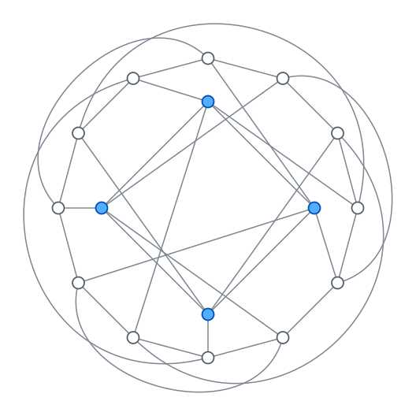

# The minimum number of edges at treewidths seven and eight

All graphs are finite, simple, and undirected.

**Theorem.**

1. Every graph with at most 27 edges has treewidth at most six.
2. Every graph with at most 33 edges has treewidth at most seven.
3. There is a graph with 34 edges and treewidth exactly eight.

Since $K_8$ has 28 edges and treewidth seven, the minimum number of edges of
a graph of treewidth seven is 28, and the minimum at treewidth eight is 34.
Together with Section 2 and $34<\binom{9}{2}=36$, this shows that

$$
\min\left\lbrace k : \exists G,\ \mathrm{tw}(G)=k,\ |E(G)|<\binom{k+1}{2}\right\rbrace=8.
$$

The proof combines a published bound, elementary reductions, and one
exhaustive enumeration of 96,841,893 graphs (Section 3).

## 1. Tools

**Joret–Wood bound.** Joret and Wood prove that every connected graph with
$m$ edges has a set $X$ of at most $3(m+1)/16$ vertices such that $G-X$ has
treewidth at most two
([Theorem 1.2](https://arxiv.org/abs/1605.04730); SIAM Journal on Discrete
Mathematics 32(1), 123–147, 2018). Adding $X$ to every bag of a width-two
decomposition of $G-X$, and taking the maximum over components, gives for
every graph

$$
\mathrm{tw}(G)\le 2+\left\lfloor\frac{3(m+1)}{16}\right\rfloor. \qquad(1)
$$

In particular, a graph with at most 20 edges has treewidth at most five, and
a graph of treewidth at least seven has at least 26 edges.

**Elimination.** *Eliminating* a vertex $v$ of degree $d$ means deleting $v$
and making its neighborhood $N(v)$ a clique. Call the result $H$. Every tree
decomposition of $H$ has a bag containing the clique $N(v)$; attaching a new
bag $N(v)\cup\lbrace v\rbrace$ to it gives a decomposition of $G$. So

$$
\mathrm{tw}(G)\le\max\lbrace d,\mathrm{tw}(H)\rbrace,\qquad
|E(H)|=|E(G)|-d+\binom{d}{2}-|E(G[N(v)])|. \qquad(2)
$$

Elimination preserves connectedness. If $1\le d\le3$, it does not increase
the number of edges, and it keeps the edge count the same exactly when $d=3$
and $N(v)$ is independent.

**Triangle-to-star replacement** deletes the three edges of a triangle and
adds a new vertex adjacent to its three vertices. It is the reverse of
eliminating a degree-three vertex with an independent neighborhood. It never
raises treewidth above $\max\lbrace3,\mathrm{tw}(G)\rbrace$: some bag contains
the triangle, so attach a bag containing the triangle and the new vertex,
then delete the triangle edges.

**Deleting a vertex** lowers treewidth by at most one: add the vertex back to
every bag. **Adding edges** never lowers treewidth.

## 2. Treewidths one to six

For $k\le6$, every graph with fewer than $\binom{k+1}{2}$ edges has treewidth
below $k$, so $K_{k+1}$ is optimal.

For $k=4,5,6$ this follows from (1): at most 9, 14, or 20 edges give
treewidth at most 3, 4, or 5. For $k=1$, a graph with no edges has treewidth
zero. For $k=2$, a graph with at most two edges is a forest.

For $k=3$, suppose a graph with at most five edges has treewidth at least
three, and choose one with the fewest vertices. Eliminating a vertex of
degree at most two keeps treewidth at least three and does not increase the
number of edges, by (2). So the minimum degree is at least three, giving
$3n\le10$ and $n\le3$. But a graph on at most three vertices has treewidth at
most two, a contradiction.

## 3. The computation

Nauty's `geng` generates exactly one graph from each isomorphism class of
connected graphs with 28 edges, 8–14 vertices, and degrees 4–7:

```text
geng -c -d4 -D7 n 28:28        (n = 8, ..., 14)
```

No other filters are applied.

| Vertices | Graphs | Without a width-six elimination order |
| ---: | ---: | ---: |
| 8 | 1 | 1 |
| 9 | 106 | 0 |
| 10 | 101,336 | 0 |
| 11 | 9,555,744 | 0 |
| 12 | 62,893,242 | 1 |
| 13 | 24,203,296 | 0 |
| 14 | 88,168 | 0 |
| **Total** | **96,841,893** | **2** |

**Fact A.** Every one of these graphs has treewidth at most six, except
$K_8$ and the 12-vertex graph $F$ with graph6 code `K?bFBO{}?}Ug`:

```text
 0:  4  5  6  9 11
 1:  5  6  7  9
 2:  6  7  8  9 11
 3:  8  9 10 11
 4:  0  7  8  9 10
 5:  0  1  8 10 11
 6:  0  1  2 10
 7:  1  2  4 10 11
 8:  2  3  4  5
 9:  0  1  2  3  4
10:  3  4  5  6  7
11:  0  2  3  5  7
```

Both $K_8$ and $F$ have treewidth exactly seven. The only triangles of $F$
are $(0,4,9)$, $(0,5,11)$, $(2,7,11)$, and $(4,7,10)$.

**Fact B.** Deleting any one edge of $K_8$ or $F$, or replacing any one
triangle of $K_8$ or $F$ by a star, gives a graph of treewidth at most six.

For $K_8$, Fact B is easy to see by hand. In $K_8$ minus an edge, eliminate an
endpoint of the missing edge (degree six), leaving $K_7$. After a
triangle-to-star replacement, each former triangle vertex has six neighbors,
and eliminating all three leaves a clique on six vertices. For $F$, Fact B is
checked by computer: 28 edge deletions and 4 triangle replacements, each with
a saved width-six elimination order.

## 4. Graphs with at most 28 edges and treewidth at least seven

**Claim.** Every connected graph with at most 28 edges and treewidth at least
seven is isomorphic to $K_8$ or $F$.

*Proof.* Let $H$ be such a graph. Repeatedly eliminate vertices of degree at
most three until none remain, and call the result $J$. By (2), $J$ is
connected, has treewidth at least seven, and has $m=|E(J)|\le28$ edges. Its
minimum degree is at least four because the process stopped.

By (1), $m\ge26$. Since $\mathrm{tw}(J)\ge7$, $J$ has at least 8
vertices, and since $4|V(J)|\le2m\le56$, it has at most 14. For every vertex
$v$, $J-v$ has treewidth at least six, so it has at least 21 edges by (1);
hence $\deg v\le m-21$.

Add $28-m$ new edges to $J$; there are enough non-edges, since $J$ has at
least 8 vertices. The result $J^+$ is connected, has 28 edges, 8–14 vertices,
minimum degree at least four, and maximum degree at most
$(m-21)+(28-m)=7$. Its treewidth is at least seven, so by Fact A, $J^+$ is
$K_8$ or $F$. If $m<28$, then $J$ is contained in $J^+$ minus one of the new
edges, which has treewidth at most six by Fact B, a contradiction. So $m=28$
and $J$ is $K_8$ or $F$.

Finally, $H$ had at most 28 edges and $J$ has 28, and no elimination
increased the edge count. So every elimination kept it the same, which by
(2) means each eliminated vertex had degree three and an independent
neighborhood. Reversing the eliminations therefore turns $J$ into $H$ by
triangle-to-star replacements. If there was at least one, the first gives
treewidth at most six by Fact B, and later ones cannot raise it above six.
This contradicts $\mathrm{tw}(H)\ge7$, so $H=J$. $\square$

**Part 1 of the theorem follows.** A graph with at most 27 edges and
treewidth at least seven would have a component with the same properties.
By the claim that component would be $K_8$ or $F$, but both have 28 edges.

## 5. Graphs with at most 33 edges

Suppose some graph with at most 33 edges has treewidth at least eight, and
let $G$ be one with the fewest vertices. It is connected, and its minimum
degree is at least four: eliminating a vertex of degree at most three would
give a smaller example, by (2).

Let $m=|E(G)|$ and $n=|V(G)|$. For every vertex $v$, $G-v$ has treewidth at
least seven, so it has at least 28 edges by part 1. Hence

$$
4\le\deg v\le m-28\le5,
$$

so $m$ is 32 or 33. If $m=32$, $G$ is 4-regular and $n=16$. If $m=33$,
$4n\le66\le5n$ gives $14\le n\le16$, and some vertex has degree five because
$66$ is not divisible by four. Either way, deleting a vertex $v$ of degree
$m-28$ leaves a graph $H$ with exactly 28 edges, 13–15 vertices, minimum
degree at least three, and treewidth at least seven.

$H$ is connected: a component of treewidth at least seven has at least 28
edges by part 1, so it has all of them, and any other component would have
no edges, contradicting minimum degree three. By the claim, $H$ is $K_8$ or
$F$, with 8 or 12 vertices. This contradicts $|V(H)|\ge13$, proving part 2.

## 6. A 34-edge graph of treewidth eight

The following graph is 4-regular and triangle-free, with 17 vertices and 34
edges. Its graph6 code is

```text
Ps`aa?aGOgAGBCA`@L?@K?ES
```

and its adjacency lists are

```text
 0: 1 2 3 4
 1: 0 5 6 7
 2: 0 5 8 9
 3: 0 6 10 11
 4: 0 12 13 14
 5: 1 2 10 12
 6: 1 3 8 13
 7: 1 9 11 14
 8: 2 6 14 15
 9: 2 7 12 16
10: 3 5 14 16
11: 3 7 13 15
12: 4 5 9 15
13: 4 6 11 16
14: 4 7 8 10
15: 8 11 12 16
16: 9 10 13 15
```

The elimination order `0, 1, 2, 3, 5, 6, 4, 7, 8, 9, 10, 11, 12, 13, 14, 15, 16`
has width eight, and a closed-prefix certificate of 8,205 sets (Section 7)
excludes width seven. So its treewidth is exactly eight, proving part 3.

The graph is from the House of Graphs file of
[17-vertex quartic graphs of girth at least four](https://houseofgraphs.org/data/quartics/17_4_4.g6.gz)
and is not claimed as a new construction. A 35-edge example of treewidth
eight, the circulant on 14 vertices with steps 1, 4, and 7, was given earlier
in Devon's comment on the
[TCS Stack Exchange question](https://cstheory.stackexchange.com/questions/53806/what-is-the-smallest-graph-of-treewidth-k-having-less-edges-than-the-k1-c).

## 7. How the computation is certified

An elimination order of width $w$ proves treewidth at most $w$. A
*closed-prefix certificate* proves treewidth greater than $w$: it is a family
of sets of eliminated vertices that contains the empty set, contains
$S\cup\lbrace v\rbrace$ whenever it contains $S$ and $v$ has at most $w$ neighbors in
the graph filled after eliminating $S$, and does not contain the full vertex
set. Any width-$w$ order would build the full set one step at a time inside
the family, so none exists.

- **Fact A.** A C search finds each width-six order, trying a minimum-fill
  greedy order first and then searching all elimination prefixes. A separate
  C routine checks every order without the search's filling code: after
  eliminating a set $S$, two remaining vertices are adjacent exactly when an
  original path joins them through $S$. Any failure aborts the run. Orders
  that needed search beyond greedy are checked again in Python by explicit
  filling. An unmodified `geng` count-only run agrees with every count.
- **Exact treewidth of $K_8$, $F$, and the 34-edge graph.** Each has a
  saved elimination order and a saved closed-prefix certificate, checked in
  Python independently of the code that produced them.
- **Fact B.** Every reduction of $K_8$ and $F$ has a saved width-six order
  found in C and checked in Python.
- **Audit.** The C decision routine agrees with an independent Python
  subset dynamic program, at the exact width and one below it, on all 1,252
  unlabeled graphs on at most seven vertices and on 48 seeded random graphs:
  2,600 comparisons.

The proof relies on the Joret–Wood theorem, the completeness of `geng`, and
these verifiers. None has been formally verified in a proof assistant. See
the [README](README.md) to reproduce the computation.

## 8. Classification at 34 edges: exactly two connected graphs

**Theorem.** Up to isomorphism, there are exactly **two** connected graphs
with 34 edges and treewidth eight. They have 16 and 17 vertices, respectively,
and both are triangle-free. Thus the 17-vertex witness is **not unique**.
For arbitrary graphs, the only additional freedom is to add isolated vertices.

This section uses an additional exhaustive computation, reproduced by
`scripts/reproduce_uniqueness.py`. Sections 1–7 and their reproduction do not
depend on this classification.

### The second graph

<p align="center">
  
</p>

The new 16-vertex graph has graph6 code `O?qbF_WF_cA__IOBCC_Af` and adjacency
lists

```text
 0:  4  5  7 12
 1:  4  6  7 13
 2:  5  6  7 14
 3:  7  8  9 10 11
 4:  0  1  8  9
 5:  0  2  9 11
 6:  1  2  9 10
 7:  0  1  2  3 15
 8:  3  4 12 14
 9:  3  4  5  6 15
10:  3  6 12 13
11:  3  5 13 14
12:  0  8 10 15
13:  1 10 11 15
14:  2  8 11 15
15:  7  9 12 13 14
```

It has twelve vertices of degree four and four of degree five, hence 34 edges.
The order `0, 1, 2, 8, 10, 11, 9, 3, 4, 5, 6, 7, 12, 13, 14, 15` has width
eight. A closed-prefix certificate of **3,621** sets excludes width seven.
Both certificates are saved in `sources/witness34-16.json` and independently
verified by the Python routines of Section 7. Different vertex counts prove
that the two witnesses are not isomorphic. This alone disproves uniqueness,
independently of the exhaustive work below.

### Reduction to degrees four and five

Let $G$ be connected with 34 edges and treewidth at least eight. Repeatedly
eliminate vertices of degree at most three. By Section 5, no elimination can
lose an edge: otherwise the resulting graph would have at most 33 edges and
treewidth at least eight. Thus each eliminated vertex has degree three and
an independent neighborhood. The resulting connected core $C$ has 34 edges,
treewidth at least eight, and minimum degree at least four.

Deleting any vertex leaves treewidth at least seven, hence at least 28
edges. Therefore every degree in $C$ is at most six. If a vertex $v$ has
degree six, $C-v$ has exactly 28 edges and minimum degree at least three.
Its component of treewidth at least seven uses all 28 edges; any other
component would be an isolated vertex, excluded by the minimum degree.
By Section 4, $C-v$ is $K_8$ or $F$. The former contradicts the maximum
degree six in $C$. All $\binom{12}{6}=924$ ways of adjoining a degree-six
vertex to $F$ have verified width-seven orders, so the latter is impossible
as well. These orders are saved in `sources/uniqueness.json`.

Consequently the core has degrees four and five. The handshake lemma leaves
only the following cases:

| Vertices | Degree four | Degree five |
| ---: | ---: | ---: |
| 14 | 2 | 12 |
| 15 | 7 | 8 |
| 16 | 12 | 4 |
| 17 | 17 | 0 |

### Covering the degree-five cases through 29-edge graphs

Suppose $C$ has a degree-five vertex $v$, and put $H=C-v$. Then $H$ has
29 edges, 13–15 vertices, degrees 3–5, and treewidth at least seven.
It is connected: a component of treewidth at least seven uses at least 28
edges, and a second component of minimum degree three would use at least
six more.

Eliminate degree-three vertices from $H$. Each step keeps treewidth at least
seven, so the edge count can drop by at most one in total. A degree-three
elimination loses exactly the number of edges inside its neighborhood.
Hence this neighborhood has either zero or one edge. In both cases none of
the remaining degrees decreases, so no vertex of degree less than three is
created. There are two possible outcomes:

1. The process reaches minimum degree four with 29 edges. There are 9–14
   vertices. Deleting any vertex leaves treewidth at least six, requiring at
   least 21 edges; hence the maximum degree is at most eight.
2. A step loses one edge. The resulting connected 28-edge graph is already
   $K_8$ or $F$, by Section 4, so it has minimum degree at least four and the
   process stops.

All graphs in the first case are covered by

```text
geng -c -d4 -D8 n 29:29        (n = 9, ..., 14)
```

Every generated graph except the following survivors has a width-six order
checked by the separate C order verifier:

| Vertices | Graphs | Survivors |
| ---: | ---: | ---: |
| 9 | 133 | 1 |
| 10 | 131,639 | 0 |
| 11 | 18,336,090 | 0 |
| 12 | 230,446,743 | 77 |
| 13 | 256,853,749 | 40 |
| 14 | 12,303,420 | 6 |
| **Total** | **518,071,774** | **124** |

Unmodified `geng` count-only runs agree with each count. All 124 survivor
encodings are saved in `sources/uniqueness.json`.

To reverse the second case, start from $K_8$ or $F$, choose a triangle and
one edge to retain, delete its other two edges, and add a new vertex adjacent
to all three triangle vertices. This reverses the single edge-losing step
and gives 29 edges. There are $3(56+4)=180$ such starting graphs, in addition
to the 124 cores of the first case.

From each of these **304** starting graphs, perform every sequence of
ordinary triangle-to-star replacements that could lead to $H$:

- Degrees never increase, so discard any branch with a degree below three.
  Every newly introduced vertex has degree three and cannot participate in
  another replacement. Ordinary replacements create no triangles; thus it
  suffices to choose edge-disjoint triangles from the starting graph. These
  replacements commute, so considering them in increasing triangle order
  covers every result up to relabeling of the new vertices.
- The number of degree-three vertices never decreases. Discard a branch
  once there are more than five: adjoining $v$ cannot raise all their degrees
  to four. The implementation also stops beyond 16 vertices, a harmless
  superset of the required upper bound of 15.
- Discard any intermediate graph with a verified width-six order.
  Triangle-to-star replacement preserves that bound, and adjoining $v$
  raises treewidth by at most one, so such a branch cannot produce $C$.
- Whenever the reconstructed graph has the required size and degrees 3–5,
  adjoin $v$ to all its degree-three vertices and to every possible choice of
  degree-four vertices bringing its degree to five. Degree-five vertices
  cannot be chosen. The implementation also admits size 16 here; no graph
  of that size qualifies, since 29 edges are insufficient for all but at
  most five of its vertices to have degree at least four.

`scripts/extend29.py` implements this finite reconstruction. It checks
**15,091** distinct labeled candidates (different candidates may be
isomorphic):

| Vertices of $C$ | Candidates | Without a width-seven order |
| ---: | ---: | ---: |
| 14 | 1,045 | 0 |
| 15 | 12,858 | 0 |
| 16 | 1,188 | 1 |

The sole survivor is the 16-vertex graph displayed above. The saved
reconstruction contains all pruning orders and all successful final orders.
`scripts/verify_uniqueness.py` replays the entire reconstruction using these
certificates, verifies every pruning step and upper bound in Python, and
checks that no attachment is omitted.

### The quartic case and undoing the original eliminations

For 17 vertices the core is 4-regular. Nauty's specialized `genquarticg`, by
Brendan McKay and S. Narjess Afzaly, enumerates **86,221,634** connected graphs
with `genquarticg -c 17`, agreeing with the
[published count](https://www.mathe2.uni-bayreuth.de/markus/reggraphs.html).
All are checked, including graphs with triangles. `scripts/quartic_plugin.c`
uses the generator's `OUTPROC` hook to call the search and separate order
verifier from Section 7 directly, and compares the checker count with the
generator's own counter. Exactly one graph lacks a width-seven order: a
graph isomorphic to the 17-vertex witness of Section 6. The explicit
isomorphism is saved and verified in Python; the witness's saved certificates
establish treewidth eight.

The complete quartic check was independently repeated using the unmodified
[GENREG generator](https://sourceforge.net/p/genreg/code/HEAD/tree/trunk/).
It gives the same count and the same sole survivor up to isomorphism.
`scripts/check_quartic.c` reads its shortcode stream, checks simplicity,
degrees and connectivity, and calls the same search and separate order
verifier. Both generators' results and source hashes are recorded in
`sources/uniqueness.json`. The default reproduction uses `genquarticg`;
`--cross-check-genreg` also repeats the independent generation. The general
`geng -c -d4 -D4 17 34:34` is available as a slower alternative.

Thus there are exactly two possible cores, both triangle-free. Reversing any
of the original degree-three eliminations requires a triangle, so neither
core admits even a first reversal. Therefore $G$ equals its core. For a
disconnected graph, a treewidth-eight component already uses all 34 edges,
and every other component is isolated. This proves the classification.

As before, this is a computer-assisted proof, not a formal verification.
It additionally relies on `genquarticg`'s exhaustive generation. The independent
GENREG cross-check uses a separate generation algorithm and a shortcode
decoder. The certificate-only checks do not establish completeness of either
large enumeration; use `scripts/reproduce_uniqueness.py` to repeat them.
